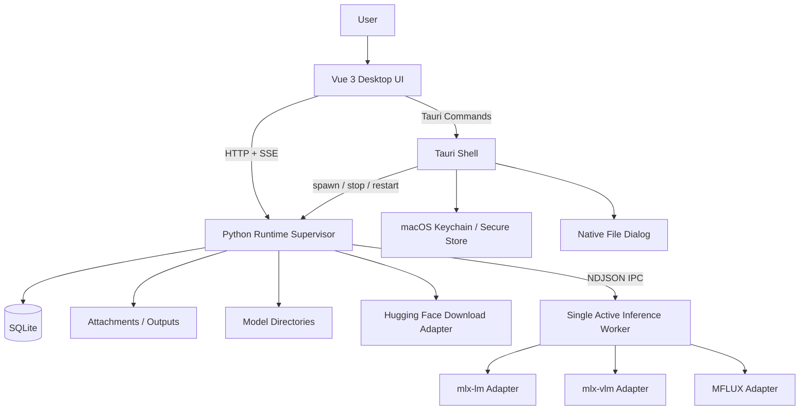

# MLX 本地 AI 工作台：产品技术开发文档

> 暂定产品名：**MLX Studio**  
> 文档状态：可执行开发基线  
> 目标平台：Apple Silicon Mac  
> 产品形态：Tauri 2 桌面应用 + Vue 3 Web UI + Python MLX Runtime  
> 支持范围：MLX 文本模型、多模态理解模型、生图与图片编辑模型

---

## 1. 文档目标

本文档不是概念方案，而是后续研发、拆任务、代码审查和阶段验收的共同基线。它解决以下问题：

1. 第一版到底做什么，不做什么。
2. 桌面壳、前端、Runtime、模型引擎之间如何分层。
3. 如何保证高内聚、低耦合，并让 MLX 生态升级时不牵动整个产品。
4. 每个开发阶段的明确目标、交付物、验证方式和退出条件。
5. 如何通过测试、静态检查、性能基线和真实模型验证保证质量。
6. 如何避免大文件、万能 Service、组件重复造轮子和副作用扩散。

所有阶段遵守一个原则：

> **先完成可验证的纵向闭环，再增加模型类型和产品能力。未满足阶段退出条件，不进入下一阶段。**

---

## 2. 产品定义

### 2.1 产品定位

MLX Studio 是面向 Apple Silicon 的本地 AI 工作台，负责：

- 发现、导入和下载 MLX 模型。
- 管理模型加载、卸载、切换和内存释放。
- 提供文本聊天、图片理解、音频/视频理解。
- 提供文生图、图生图和后续图片编辑能力。
- 保存会话、附件、生成结果与运行参数。
- 对外提供可选的本地 OpenAI 风格 API。
- 将 Python、依赖、Runtime 生命周期隐藏在桌面应用内部。

### 2.2 第一版目标

第一版完成以下闭环：

```text
安装应用
  → 导入或下载一个 MLX 模型
  → 加载模型
  → 发起文本或多模态请求
  → 流式查看结果
  → 停止生成
  → 保存会话
  → 卸载并释放内存
  → 切换到生图模型生成图片
```

### 2.3 第一版非目标

以下能力不进入 1.0 主线：

- Intel Mac、Windows、Linux、CUDA。
- 模型训练、SFT、LoRA 训练和量化平台。
- 多用户、账号体系、云同步。
- 局域网公开服务和远程访问。
- Agent、MCP、浏览器自动化和复杂工具调用。
- ComfyUI 式节点工作流。
- 任意 Python 插件执行。
- 同时常驻多个大型模型。
- 对所有 Hugging Face 模型承诺兼容。

这些能力可以在架构上保留扩展点，但不得提前增加主流程复杂度。

---

## 3. 核心架构决策

### 3.1 技术主线

```text
桌面交付       Tauri 2
前端           Vue 3 + Vite + TypeScript
组件库         Naive UI
状态管理       Pinia
通用组合函数   VueUse
Runtime        Python 3.12 + uv + FastAPI
文本推理       mlx-lm Adapter
多模态推理     mlx-vlm Adapter
图像生成       MFLUX Adapter
持久化         SQLite + 本地文件系统
进程通信       HTTP + SSE + NDJSON IPC
桌面进程管理   Tauri Sidecar
```

### 3.2 不直接依赖上游 Server

`mlx_lm.server`、`mlx_vlm.server` 可作为能力参考和兼容性对照，但产品 Runtime 不直接把它们当成最终服务进程。

正式实现调用各模型库的 Python API，并封装为内部 Engine Adapter，原因如下：

- 产品需要统一模型状态和错误协议。
- 产品需要统一取消、指标、日志和任务生命周期。
- 产品需要决定模型如何加载和何时卸载。
- 产品需要隔离上游 API 变化。
- 产品需要在文本、多模态、生图引擎之间统一调度。
- 产品需要控制安全选项，例如 `trust_remote_code`。

### 3.3 Supervisor + 单活 Worker

采用两层 Python 进程：

```text
Runtime Supervisor
  ├─ 提供 FastAPI
  ├─ 管理任务、数据库、下载和事件
  ├─ 不直接持有大型模型
  └─ 启动一个 Active Worker
         ├─ text worker
         ├─ vlm worker
         └─ image worker
```

第一版同一时间只允许一个 Active Worker 持有大型模型。

这样设计的收益：

- 终止 Worker 即可确定性释放模型内存。
- 模型崩溃不会直接带走 Runtime API 和本地数据。
- 上游模型库出现内存泄漏时可以通过重建 Worker 恢复。
- 文本、VLM、生图依赖可以通过 Adapter 和 Worker 类型隔离。
- 后续可在不改前端协议的情况下升级为多 Worker。

### 3.4 Functional Core, Imperative Shell

业务规则尽量写成纯函数，副作用只存在于边界。

纯函数负责：

- 解析模型元数据。
- 推导模型能力。
- 构建推理请求。
- 计算模型切换计划。
- 状态机转移。
- 生成错误展示信息。
- 参数校验和默认值合并。
- 会话消息归一化。

副作用边界负责：

- 文件读取和写入。
- 数据库访问。
- HTTP 请求。
- Hugging Face 下载。
- 模型加载与推理。
- Worker 启停。
- Tauri 系统调用。
- 系统通知和日志输出。

禁止在 Vue 组件、Pinia getter、领域函数中偷偷执行副作用。

---

## 4. 总体架构



### 4.1 进程职责

#### Vue UI

只负责：

- 用户交互。
- 页面和组件渲染。
- View State。
- 调用 Application Client。
- 消费 SSE 事件并更新视图状态。

不得负责：

- 判断某模型具体属于哪种架构。
- 直接拼装上游 MLX 库参数。
- 直接读写 SQLite。
- 直接访问任意本地路径。
- 直接管理 Runtime 子进程。

#### Tauri Shell

只负责：

- 应用生命周期。
- Sidecar 启动、停止和崩溃检测。
- 生成一次性会话 Token。
- 安全地向前端提供 Runtime 连接信息。
- 原生文件选择器、系统菜单、通知、自动更新。
- 最小化权限控制。

Rust 层保持薄，不承载模型业务和会话业务。

#### Runtime Supervisor

负责：

- 内部 API 与可选外部 API。
- 会话、模型、任务、下载和设置。
- Worker 管理。
- 统一事件流。
- 错误映射。
- 数据库和文件存储。
- 运行指标和诊断信息。

#### Inference Worker

负责：

- 加载一个指定模型。
- 执行一种 Engine Adapter。
- 流式发送推理事件。
- 响应协作式取消。
- 提供硬终止兜底。

Worker 不访问业务数据库，不决定产品流程。

---

## 5. 工程原则

### 5.1 高内聚

同一个业务能力的领域规则、用例、API Client、状态和 UI 放在同一个模块内，例如：

```text
modules/chat/
  domain/
  application/
  api/
  stores/
  components/
  pages/
  tests/
```

禁止把所有类型都放进全局 `types/`，把所有请求都放进全局 `api/`，把所有函数都放进 `utils.ts`。

### 5.2 低耦合

依赖方向必须单向：

```text
UI → Application → Domain
Infrastructure → Domain Ports
Entrypoint → Application
```

领域层不得依赖：

- Vue、Pinia、Naive UI。
- FastAPI、Pydantic。
- Tauri。
- MLX、mlx-lm、mlx-vlm、MFLUX。
- SQLite、HTTP Client。

### 5.3 不过度抽象

只在以下边界定义 Port/Adapter：

- 模型引擎。
- 数据库存储。
- 文件系统。
- 下载服务。
- Worker IPC。
- 桌面平台能力。
- 时钟、ID 生成器等需要测试替换的能力。

普通纯函数不套 Repository、Manager、Factory。没有第二个真实实现前，不因为“未来可能”创建复杂继承层级。

### 5.4 组合优先

- Vue 使用 Composition API 和 `<script setup lang="ts">`。
- Python 使用小对象、`Protocol` 和函数组合。
- Rust 使用小模块和显式命令。
- 不使用深继承。
- 不创建万能基类。

### 5.5 单文件长度约束

以下为软限制，超过即要求评估拆分：

| 文件类型 | 建议上限 | 硬上限 | 处理方式 |
|---|---:|---:|---|
| Vue SFC | 220 行 | 320 行 | 拆展示组件、composable、纯函数 |
| TypeScript | 220 行 | 350 行 | 按领域能力拆模块 |
| Python | 250 行 | 400 行 | 拆 use case、adapter、mapper |
| Rust | 250 行 | 400 行 | 拆 command、process、security |
| 单个函数 | 35 行 | 60 行 | 提取命名明确的纯函数 |
| 单个测试文件 | 350 行 | 500 行 | 按行为分组 |

例外：生成代码、数据库迁移、常量数据、模型兼容清单。例外文件必须放入明确目录，不参与普通文件长度检查。

### 5.6 复杂度约束

- 单函数圈复杂度建议不超过 8，硬限制 12。
- 嵌套深度不超过 3 层。
- 参数超过 4 个时使用具名参数对象。
- 一个函数只做一个可命名动作。
- 禁止布尔参数控制两套完全不同流程，改为显式策略或两个函数。
- 禁止大范围 `try/except Exception`，仅允许在进程、HTTP 和任务顶层统一兜底。

---

## 6. 前端设计

### 6.1 组件库策略

第一版采用 **Naive UI** 作为基础组件库，使用：

- Layout、Menu、Tabs。
- Form、Input、Select、Slider、Switch。
- Modal、Drawer、Dialog。
- Upload、Progress。
- DataTable、Tree、VirtualList。
- Dropdown、Popover、Tooltip。
- Message、Notification、Result、Empty、Skeleton。

通用能力采用 VueUse，例如：

- `useEventListener`。
- `useStorage`。
- `useClipboard`。
- `useDark`。
- `useDebounceFn`。
- `useResizeObserver`。

禁止重复实现：

- Button、Input、Modal、Select、Tooltip、Upload、Table。
- Toast、Dialog、Notification。
- 常规 loading、empty、result 状态。
- 常见浏览器与响应式组合函数。

允许自研的必须是产品领域组件，例如：

- `MessageBubble`。
- `ChatComposer`。
- `ModelPicker`。
- `RuntimeStatus`。
- `GenerationMetrics`。
- `ImageGenerationPanel`。
- `JobQueuePanel`。

不为每个 Naive UI 组件再包一层 `AppButton`、`AppInput`。只有需要统一业务行为、可访问性或跨组件库迁移时才创建薄封装。

### 6.2 前端目录

```text
apps/desktop/
  src/
    app/
      bootstrap/
      router/
      providers/
      theme/
    modules/
      runtime/
      models/
      chat/
      multimodal/
      image-studio/
      settings/
    shared/
      api/
      domain/
      ui/
      lib/
      errors/
    pages/
    main.ts
  src-tauri/
```

每个业务模块内部结构：

```text
modules/chat/
  domain/
    chat-message.ts
    chat-state.ts
    chat-reducer.ts
    build-chat-request.ts
  application/
    send-message.ts
    cancel-response.ts
  api/
    chat-client.ts
    chat-mappers.ts
  stores/
    chat.store.ts
  components/
    MessageList.vue
    MessageBubble.vue
    ChatComposer.vue
  pages/
    ChatPage.vue
  tests/
```

### 6.3 Vue 组件职责

页面组件：

- 组合 feature components。
- 触发页面级加载。
- 不包含复杂业务规则。

容器组件：

- 读取 Store。
- 调用 Application Action。
- 将数据和回调传给展示组件。

展示组件：

- Props 输入、Events 输出。
- 不直接调用 API。
- 不读取全局 Store。
- 尽量可在 Storybook 或独立测试中渲染。

Composable：

- 封装 Vue 生命周期与浏览器/Tauri 副作用。
- 领域计算放到普通 TypeScript 纯函数，不塞进 composable。

### 6.4 Pinia 使用边界

Pinia 只管理：

- 当前页面 View State。
- 当前选择项。
- 运行中的请求状态。
- 客户端缓存。

Pinia 不作为数据库，不保存大型二进制，不承载全部领域逻辑。

推荐方式：

```ts
// 纯函数
export const reduceChatState = (
  state: ChatState,
  event: ChatEvent,
): ChatState => {
  // 无网络、无时间、无随机数、无 Store 引用
  return nextState
}

// Store 只负责副作用编排
export const useChatStore = defineStore('chat', () => {
  const state = ref(initialChatState)

  const send = async (command: SendMessageCommand) => {
    state.value = reduceChatState(state.value, { type: 'send.started' })
    await chatApplication.send(command)
  }

  return { state, send }
})
```

### 6.5 API 类型

- FastAPI OpenAPI 是 DTO 的事实来源。
- 前端通过代码生成获得 TypeScript 类型。
- 禁止手写一套与后端重复的 Request/Response 类型。
- SSE 事件使用带 `type` 的可辨识联合类型。
- Runtime 握手包含 `protocol_version`，协议不兼容时 UI 必须阻止继续调用。

---

## 7. Runtime 分层设计

### 7.1 目录结构

```text
services/runtime/
  pyproject.toml
  uv.lock
  src/mlx_studio_runtime/
    domain/
      models/
      jobs/
      conversations/
      events/
      errors/
      policies/
    application/
      use_cases/
      commands/
      queries/
      dto/
    ports/
      engine.py
      model_repository.py
      conversation_repository.py
      file_store.py
      download_provider.py
      worker_host.py
      event_publisher.py
    adapters/
      engines/
        mlx_lm_engine.py
        mlx_vlm_engine.py
        mflux_engine.py
      persistence/
        sqlite/
      downloads/
        huggingface.py
      files/
      worker/
        ndjson_worker_host.py
    entrypoints/
      http/
        internal/
        openai_compatible/
        middleware/
      worker/
        main.py
    bootstrap/
      container.py
      settings.py
      logging.py
    migrations/
  tests/
    unit/
    contract/
    integration/
    system/
```

### 7.2 Engine Port

Engine 只描述产品需要的能力，不暴露上游库对象：

```python
class InferenceEngine(Protocol):
    def describe(self) -> EngineDescriptor: ...

    async def load(self, model: ModelSpec) -> LoadedModelInfo: ...

    async def generate(
        self,
        request: GenerationRequest,
        cancellation: CancellationToken,
    ) -> AsyncIterator[GenerationEvent]: ...

    async def unload(self) -> None: ...
```

Adapter 内部负责：

- 上游参数映射。
- Prompt Template。
- Tokenizer/Processor。
- 多模态输入准备。
- 流式结果归一化。
- 上游异常映射。

Application 和 UI 不得出现 `mlx_lm.load`、`mlx_vlm.generate`、MFLUX 模型类名。

### 7.3 Worker IPC

Supervisor 与 Worker 使用按行 NDJSON：

命令：

```json
{"id":"cmd-1","type":"worker.load","payload":{}}
{"id":"cmd-2","type":"generation.start","payload":{}}
{"id":"cmd-3","type":"generation.cancel","payload":{}}
{"id":"cmd-4","type":"worker.shutdown","payload":{}}
```

事件：

```json
{"seq":1,"type":"worker.ready","payload":{}}
{"seq":2,"type":"model.loading","payload":{}}
{"seq":3,"type":"model.loaded","payload":{}}
{"seq":4,"type":"generation.delta","payload":{"text":"..."}}
{"seq":5,"type":"generation.completed","payload":{}}
```

要求：

- 每条消息必须有协议版本。
- 每个命令必须有 ID。
- 每个生成任务必须有 `job_id`。
- Event `seq` 单调递增。
- stdout 只输出协议消息，普通日志写 stderr。
- 无法解析的协议消息视为 Worker 故障。

### 7.4 取消策略

两级取消：

1. **协作式取消**：Adapter 在 token/step 循环中检查 CancellationToken。
2. **硬终止**：超出取消宽限期，Supervisor 终止 Worker，并将任务标记为 cancelled。

任何取消都必须产生唯一终态：

```text
succeeded | failed | cancelled
```

不得长期停留在 cancelling。

---

## 8. 领域模型

### 8.1 ModelManifest

```ts
interface ModelManifest {
  id: string
  displayName: string
  source: 'huggingface' | 'local'
  sourceRef?: string
  revision?: string
  localPath: string
  engine: 'mlx-lm' | 'mlx-vlm' | 'mflux'
  task:
    | 'text-generation'
    | 'vision-language'
    | 'omni-language'
    | 'image-generation'
    | 'image-edit'
  inputModalities: Array<'text' | 'image' | 'audio' | 'video'>
  outputModalities: Array<'text' | 'image' | 'audio'>
  quantization?: {
    bits?: number
    groupSize?: number
    mode?: string
  }
  contextLength?: number
  diskSizeBytes?: number
  estimatedMemoryBytes?: number
  capabilities: {
    streaming: boolean
    thinking: boolean
    tools: boolean
    structuredOutput: boolean
    multiImage: boolean
    imageEditing: boolean
    inpainting: boolean
    lora: boolean
  }
  compatibility: {
    status: 'unknown' | 'supported' | 'partial' | 'incompatible' | 'broken'
    runtimeVersion?: string
    reason?: string
  }
}
```

### 8.2 能力推导顺序

能力来源按优先级合并：

1. 用户或内置 Compatibility Override。
2. 已验证兼容矩阵。
3. Adapter 对模型架构的声明。
4. `config.json`、`processor_config.json`、`model_index.json` 等静态元数据。
5. 保守默认值。

禁止在 UI 中写：

```ts
modelName.includes('qwen')
```

模型名只用于展示，不能成为业务判断依据。

### 8.3 Job 状态机

```text
queued
  → preparing
  → running
  → succeeded

queued/preparing/running
  → cancelling
  → cancelled

queued/preparing/running/cancelling
  → failed
```

所有转移通过纯函数处理：

```python
def transition_job(state: JobState, event: JobEvent) -> JobState:
    ...
```

非法状态转移必须被拒绝并记录结构化错误。

### 8.4 Runtime 状态机

```text
stopped → starting → ready
starting → failed
ready → degraded
ready/degraded → stopping → stopped
failed → starting
```

### 8.5 Model 状态机

```text
discovered → downloading → available
available → loading → loaded
loaded → unloading → available
任意非终态 → error
```

---

## 9. API 设计

### 9.1 内部 API

统一前缀：

```text
/internal/v1
```

#### Runtime

```text
GET  /runtime/health
GET  /runtime/info
GET  /runtime/metrics
GET  /runtime/diagnostics
POST /runtime/restart-worker
```

#### Models

```text
GET    /models
GET    /models/{model_id}
POST   /models/scan
POST   /models/import
POST   /models/pull
POST   /models/{model_id}/load
POST   /models/{model_id}/unload
DELETE /models/{model_id}/registration
DELETE /models/{model_id}/files
```

“从模型库移除”和“删除磁盘文件”必须是两个不同操作。

#### Conversations

```text
GET    /conversations
POST   /conversations
GET    /conversations/{id}
PATCH  /conversations/{id}
DELETE /conversations/{id}
POST   /conversations/{id}/messages
POST   /conversations/{id}/regenerate
POST   /conversations/{id}/cancel
```

#### Image jobs

```text
POST /image-jobs
GET  /image-jobs
GET  /image-jobs/{id}
POST /image-jobs/{id}/cancel
```

#### Events

```text
GET /events
```

使用单一 SSE 流推送：

- Runtime 状态。
- Worker 状态。
- 模型加载进度。
- 文本 delta。
- 下载进度。
- 生图任务进度。
- 任务终态。

第一版不引入 WebSocket。只有出现真实双向实时场景时再增加。

### 9.2 对外兼容 API

默认关闭，用户主动启用后仅监听 `127.0.0.1`：

```text
GET  /v1/models
POST /v1/chat/completions
POST /v1/responses
POST /v1/images/generations
POST /v1/images/edits
```

兼容 API 与内部 API 使用不同 Token，不能复用桌面会话 Token。

### 9.3 错误协议

```json
{
  "error": {
    "code": "MODEL_NOT_SUPPORTED",
    "message": "当前 Runtime 不支持该模型架构",
    "retryable": false,
    "details": {
      "model_id": "...",
      "engine": "mlx-vlm"
    },
    "request_id": "req-..."
  }
}
```

错误码必须稳定，UI 不解析后端英文异常文本决定流程。

---

## 10. 本地存储

### 10.1 目录

```text
~/Library/Application Support/MLX Studio/
  data/
    app.db
  media/
    attachments/
    generated/
    thumbnails/
  cache/
  logs/
  runtime/
  backups/
```

模型目录默认单独设置，可选择：

```text
~/MLXModels
/Volumes/ExternalSSD/MLXModels
Hugging Face Cache
```

### 10.2 SQLite 表

- `schema_migrations`
- `settings`
- `models`
- `model_compatibility_runs`
- `conversations`
- `messages`
- `attachments`
- `jobs`
- `artifacts`
- `runtime_sessions`

原则：

- 不把图片、音频、视频放进 SQLite BLOB。
- 文件使用内容哈希或稳定 ID 命名。
- 数据库保存相对路径和元数据。
- 会话保存当时使用的模型与参数快照，不能只保存当前设置引用。
- 所有表结构变化必须有迁移。

### 10.3 敏感信息

Hugging Face Token 等敏感信息放入 macOS Keychain 或安全存储，数据库只保存引用标识。

---

## 11. 安全设计

- Runtime 只绑定 `127.0.0.1` 和随机空闲端口。
- Tauri 在每次启动时生成高强度 Session Token，通过环境变量传给 Runtime。
- Session Token 不写磁盘、不放 localStorage。
- Runtime handshake 只返回端口、PID、协议版本，不回显 Token。
- `trust_remote_code` 默认关闭。
- 开启远程代码必须逐模型确认，并显示风险提示。
- 模型扫描只读取静态元数据，不执行模型目录中的 Python 文件。
- Tauri Shell 权限采用白名单，不允许前端执行任意命令。
- 文件访问只允许用户选择的路径和应用数据目录。
- Markdown 默认禁用原始 HTML；代码高亮前做安全处理。
- 日志默认不记录完整 Prompt、附件内容和生成图片。
- 外部 API 默认关闭，并使用独立 Token。
- 导入和删除外部模型目录时区分“取消注册”与“删除文件”。

---

## 12. 分阶段开发路线

## 阶段 P0：技术可行性与风险前置

### 目标

在开发正式 UI 前验证最不确定的部分：模型调用、流式输出、多模态、生图、内存释放和桌面打包。

### 任务

- `P0-01` 实现系统探针：芯片、统一内存、macOS、Python、Metal、磁盘空间。
- `P0-02` 使用 mlx-lm Python API 跑通一个小型文本模型。
- `P0-03` 使用 mlx-vlm Python API 跑通一个小型图片理解模型。
- `P0-04` 使用 MFLUX Python API 跑通一个快速生图模型。
- `P0-05` 验证流式 token、取消和错误处理。
- `P0-06` 比较进程内 unload 与终止 Worker 后的内存回收。
- `P0-07` 验证 Tauri Sidecar 打包方案。
- `P0-08` 在无 Homebrew、无用户 Python 的干净环境验证运行。
- `P0-09` 固定第一批测试模型与版本，建立 compatibility matrix。

### 交付物

```text
docs/research/p0-feasibility-report.md
compatibility/baseline-models.yaml
benchmarks/p0-baseline.json
spikes/runtime-worker/
spikes/sidecar-packaging/
```

### 验证方案

1. 文本模型可输出不少于 100 token，并能流式接收。
2. 长文本生成可在取消后进入 `cancelled` 终态。
3. VLM 可读取一张本地图片并返回非空描述。
4. 生图可生成有效 PNG，尺寸与参数一致。
5. Worker 被终止后，进程 RSS 消失；重新启动 Worker 可再次推理。
6. 连续执行 10 次“加载 → 生成 → 终止 Worker”不崩溃。
7. 打包应用可在干净 Apple Silicon Mac 启动 Runtime。
8. 所有失败都有明确错误码和 stderr 日志。

### 退出条件

- 三类 Engine 至少各有一个固定模型通过。
- Worker 隔离被证实能解决模型内存释放问题。
- Sidecar 有至少一种可签名、可分发的打包路径。
- 不存在阻止产品继续开发的硬性兼容问题。

---

## 阶段 P1：工程骨架与质量基线

### 目标

建立可长期维护的 Monorepo、模块边界、自动检查和开发命令。

### 任务

- `P1-01` 初始化 pnpm workspace。
- `P1-02` 初始化 Vue 3 + Vite + TypeScript + Tauri 2。
- `P1-03` 初始化 Python 3.12 + uv + FastAPI。
- `P1-04` 建立前后端目录边界。
- `P1-05` 配置 ESLint、Prettier、Ruff、Pyright、rustfmt、Clippy。
- `P1-06` 配置 Vitest、pytest、Playwright。
- `P1-07` 配置依赖边界检查和循环依赖检查。
- `P1-08` 增加文件长度、函数复杂度检查。
- `P1-09` 建立 OpenAPI 类型生成。
- `P1-10` 建立统一开发、检查和构建命令。
- `P1-11` 写入 ADR 与 AGENTS.md。

### 建议根目录

```text
mlx-studio/
  apps/
    desktop/
  services/
    runtime/
  packages/
    api-client/
    protocol-generated/
  compatibility/
  benchmarks/
  docs/
    adr/
    research/
  scripts/
  pnpm-workspace.yaml
  package.json
  AGENTS.md
```

### 统一命令

```bash
pnpm bootstrap
pnpm dev
pnpm check
pnpm test
pnpm test:system
pnpm build:runtime
pnpm build:desktop
```

### 验证方案

- 新机器按 README 一次完成依赖初始化。
- `pnpm check` 同时检查 TS、Vue、Python、Rust。
- 人为制造跨层错误，边界检查可阻止提交。
- 人为制造循环依赖，CI 可失败。
- OpenAPI 修改后生成类型可检测差异。
- 示例模块满足文件长度和复杂度限制。

### 退出条件

- 空壳桌面应用可启动。
- Runtime health endpoint 可访问。
- 所有检查和测试在 CI 通过。
- 项目中没有未说明的跨层依赖。

---

## 阶段 P2：Runtime Supervisor 与 Worker 核心

### 目标

完成不依赖真实 UI 的 Runtime 核心，使模型任务拥有统一生命周期。

### 任务

- `P2-01` 定义 Engine Port 与 Adapter Registry。
- `P2-02` 实现 Worker NDJSON 协议。
- `P2-03` 实现 WorkerHost：spawn、health、cancel、terminate、restart。
- `P2-04` 实现 Job 状态机。
- `P2-05` 实现 Runtime、Model 状态机。
- `P2-06` 实现统一事件发布器。
- `P2-07` 实现 FakeEngine，用于快速测试。
- `P2-08` 接入 mlx-lm Adapter。
- `P2-09` 接入基础 SQLite 与迁移。
- `P2-10` 实现结构化日志和 request/job trace。

### 验证方案

- 使用 FakeEngine 完整跑通：加载、delta、完成、取消、失败。
- 状态机使用表驱动测试覆盖全部合法和非法转移。
- Worker 发送非法 JSON 时 Supervisor 进入 degraded，并产生可读诊断。
- Worker 异常退出时当前任务进入 failed，Runtime 本身仍可访问。
- 重启 Worker 后新任务可成功执行。
- 100 次 FakeEngine 任务无悬挂任务和事件丢失。

### 退出条件

- Runtime 可独立运行并通过 API 驱动完整任务闭环。
- 上层无需知道 MLX 库细节。
- FakeEngine 与真实 mlx-lm Adapter 通过同一套 Contract Test。

---

## 阶段 P3：Tauri 桌面生命周期与安全通信

### 目标

让桌面应用可靠地启动、连接、监控和关闭 Runtime。

### 任务

- `P3-01` Tauri 启动 Sidecar。
- `P3-02` Runtime 绑定 `127.0.0.1:0`。
- `P3-03` 实现 stdout 单行 handshake。
- `P3-04` Tauri 生成 Session Token 并通过环境变量传递。
- `P3-05` 前端通过 Tauri command 获取连接信息。
- `P3-06` 实现单实例、优雅退出和强制清理。
- `P3-07` 实现 Runtime 崩溃通知和重启。
- `P3-08` 收紧 Tauri capabilities。
- `P3-09` 完成日志目录和诊断包导出。

### 验证方案

- 应用启动后 Runtime 自动 ready，用户无需手动运行命令。
- 启动两个应用实例时只保留一个 Runtime。
- 强杀 Runtime 后 UI 在限定时间内显示故障，而不是永久 loading。
- 点击“重启 Runtime”后恢复连接。
- 退出应用后不存在残留 Python/Worker 进程。
- 未携带 Token 的 localhost 请求被拒绝。
- 修改前端参数不能执行未授权 sidecar 命令。

### 退出条件

- 桌面壳和 Runtime 生命周期稳定。
- 连接信息不持久化。
- 进程退出、崩溃、重启路径均有验证记录。

---

## 阶段 P4：文本聊天 MVP

### 目标

完成第一个用户可用的纵向产品闭环：本地文本模型聊天。

### 范围

- 单模型加载。
- 新建、重命名、删除会话。
- 流式文本。
- 停止生成。
- 重新生成。
- Markdown 与代码块。
- 温度、最大输出长度等基础参数。
- TTFT、tokens/s、输出 token 等指标。
- 会话持久化。

### 任务

- `P4-01` Chat Domain 与纯状态 reducer。
- `P4-02` Conversation Repository。
- `P4-03` Chat Application Use Cases。
- `P4-04` Chat API 与 SSE 事件。
- `P4-05` AppShell、ChatPage。
- `P4-06` MessageList、MessageBubble、ChatComposer。
- `P4-07` Markdown 安全渲染和代码高亮。
- `P4-08` Stop、Retry、Regenerate。
- `P4-09` 模型参数面板。
- `P4-10` 空状态、加载状态、错误状态。

### 验证方案

#### 自动化

- `buildChatRequest`、消息归一化、状态 reducer 纯函数单测。
- API Contract Test。
- FakeEngine E2E：发消息 → delta → completed。
- FakeEngine E2E：发消息 → cancel → cancelled。
- 数据库重启恢复测试。
- Markdown XSS 用例。

#### 真实模型

- 加载固定文本模型。
- 连续进行 20 轮对话。
- 对一条回复执行停止和重新生成。
- 关闭应用后重开，会话内容完整。
- 同一模型连续加载、生成、卸载 20 次无崩溃。

### 退出条件

- 用户可以只通过 UI 完成文本对话。
- 无需终端操作。
- 所有任务都有明确终态。
- 真实模型与 FakeEngine 使用相同前端流程。

---

## 阶段 P5：模型管理

### 目标

让用户可以在产品内完成模型发现、导入、下载、校验、加载和删除。

### 范围

- 扫描 Hugging Face Cache。
- 扫描用户指定目录。
- 导入本地模型目录。
- 通过 Repo ID 下载。
- 下载进度、取消和失败恢复。
- 磁盘空间预检查。
- 模型兼容状态。
- 模型详情和能力展示。
- 安全删除。

### 任务

- `P5-01` ModelManifest 解析器。
- `P5-02` Capability Resolver。
- `P5-03` Compatibility Registry。
- `P5-04` Hugging Face Download Adapter。
- `P5-05` Download Job。
- `P5-06` 模型目录扫描。
- `P5-07` ModelsPage 与 ModelDetail Drawer。
- `P5-08` ModelPicker。
- `P5-09` 删除确认与外部路径保护。
- `P5-10` 磁盘占用统计。

### 验证方案

- 扫描过程不执行模型目录中的 Python 代码。
- 缺少权重分片、索引损坏时标记为 broken。
- 磁盘空间不足时下载前失败。
- 下载取消后再次开始可复用已有缓存。
- 外部导入模型默认只移除注册，不删除源目录。
- 每个测试模型的能力 UI 与 Compatibility Matrix 一致。
- 模型切换后旧 Worker 被回收，新模型可正常生成。

### 退出条件

- 用户无需手工复制路径或编辑配置文件。
- 不支持的模型在加载前尽可能被识别。
- 兼容性未知与明确不兼容有不同展示。

---

## 阶段 P6：多模态聊天

### 目标

在聊天流程中支持图片，并按模型能力逐步支持音频和视频。

### 范围顺序

1. 单图片理解。
2. 多图片理解。
3. 音频理解。
4. 视频理解。

只有前一项稳定后才开启后一项。

### 任务

- `P6-01` Attachment Domain。
- `P6-02` 文件选择、拖拽、粘贴。
- `P6-03` 附件复制、哈希、缩略图与元数据。
- `P6-04` capability-driven Composer。
- `P6-05` mlx-vlm Adapter。
- `P6-06` 多模态 Prompt 与 Processor 映射。
- `P6-07` Vision Cache 生命周期。
- `P6-08` 大文件校验和清理。
- `P6-09` 多模态消息展示。

### 验证方案

- 不支持图片的模型不显示图片入口。
- 强行构造非法请求时后端返回稳定错误码。
- 同一图片多轮对话可复用视觉缓存；卸载模型后缓存被清理。
- 删除会话时按策略处理附件引用。
- 多图片顺序在 UI、API、Worker 中保持一致。
- 音频/视频超限时在发送前明确提示。
- 真实模型分别完成图片、音频、视频 Smoke Test。

### 退出条件

- UI 完全由 ModelManifest 控制可用输入模态。
- 文本模型和多模态模型共用同一会话核心，不复制聊天系统。
- 多模态附件可持久化并在重启后恢复。

---

## 阶段 P7：Image Studio

### 目标

提供独立于聊天的图像生成工作区。

### 第一版范围

- 文生图。
- Seed。
- Steps。
- Width/Height。
- Quantization/模型选项。
- 批量数量。
- 任务队列。
- 取消。
- 结果画廊。
- 参数元数据。
- 使用历史参数再次生成。

图生图在基线模型稳定后加入；局部重绘、ControlNet、LoRA 管理进入后续小版本。

### 任务

- `P7-01` ImageJob Domain 与状态机。
- `P7-02` MFLUX Adapter。
- `P7-03` ImageGenerationRequest Builder。
- `P7-04` ImageStudioPage。
- `P7-05` 参数面板。
- `P7-06` JobQueuePanel。
- `P7-07` Gallery 与 Artifact Metadata。
- `P7-08` 取消和 Worker 硬终止恢复。
- `P7-09` 文本模型与生图模型切换提示。
- `P7-10` 图片保存、复制和 Finder 定位。

### 验证方案

- 相同 seed、模型和参数可保存为可复现任务快照。
- 输出图片可正常解码，尺寸、格式与请求一致。
- 取消任务最终进入 cancelled；若模型不支持 step cancel，则 Worker 被安全重建。
- 生图过程中 UI 保持响应。
- 文本模型切到生图模型时状态和进度明确。
- 连续生成 20 个任务，数据库、文件和队列状态一致。
- 删除图片记录与删除磁盘文件是两个明确操作。

### 退出条件

- 生图拥有独立工作区，不污染 Chat 模块。
- Image Engine 可替换，不让 UI 依赖具体 MFLUX 模型类。
- 生成历史可恢复和复用。

---

## 阶段 P8：稳定性、性能、安全与兼容矩阵

### 目标

从“可用”提升为“长期运行可靠”。

### 任务

- `P8-01` 内存与模型切换策略。
- `P8-02` 任务排队和资源互斥。
- `P8-03` 兼容矩阵自动执行工具。
- `P8-04` 性能基线和回归检测。
- `P8-05` 两小时与八小时 Soak Test。
- `P8-06` Runtime/Worker 故障注入。
- `P8-07` 文件与数据库损坏恢复。
- `P8-08` 安全检查。
- `P8-09` 可访问性检查。
- `P8-10` 诊断包与隐私脱敏。
- `P8-11` 外部兼容 API。

### 验证方案

#### 稳定性

- 100 次模型加载/卸载循环。
- 500 次 FakeEngine 任务。
- 50 次真实模型短请求。
- Worker 随机退出故障注入。
- 磁盘空间耗尽故障注入。
- 数据库被锁、下载中断、模型文件缺失测试。

#### 性能

记录但不跨硬件使用绝对速度排名：

- App 启动时间。
- Runtime ready 时间。
- 模型加载时间。
- TTFT。
- Prefill tokens/s。
- Decode tokens/s。
- 峰值 RSS。
- Worker 终止后的内存回收时间。
- 图片生成总耗时。

同设备、同模型、同参数相对基线回退超过 15% 时 CI 或 Nightly 报警。

#### 安全

- localhost 未授权访问。
- 路径穿越。
- 任意命令注入。
- 恶意 Markdown。
- 超大附件。
- 非法模型目录。
- `trust_remote_code` 开关。
- 日志隐私检查。

### 退出条件

- 兼容模型清单有自动化结果。
- 核心场景通过长时间运行测试。
- 故障后应用可恢复，不要求用户清理进程或数据库。
- 性能有可追踪基线。

---

## 阶段 P9：签名、分发与 1.0 发布

### 目标

形成用户可安装、可升级、可回滚的数据安全版本。

### 任务

- `P9-01` 固定 Runtime 打包方案。
- `P9-02` 生成 Apple Silicon DMG。
- `P9-03` 完成嵌套二进制签名。
- `P9-04` 完成 macOS Notarization。
- `P9-05` Beta/Stable 更新通道。
- `P9-06` 数据库迁移和回滚策略。
- `P9-07` 首次启动引导。
- `P9-08` 崩溃恢复和诊断导出。
- `P9-09` 发布兼容模型清单。
- `P9-10` 完成 Release Checklist。

### 验证方案

- 干净 Apple Silicon Mac，无 Homebrew、无 Python，完成安装和首次启动。
- Gatekeeper 不报警。
- 已下载模型在离线状态可继续使用。
- 从上一 Beta 升级后会话、模型注册和生成历史完整。
- 更新失败时旧版本仍可启动。
- 卸载应用不会默认删除外部模型目录。
- 所有嵌套 Sidecar、动态库通过签名检查。

### 退出条件

- Release Checklist 全部通过。
- 1.0 安装包在至少两种内存规格的 Apple Silicon Mac 上验证。
- 数据迁移和更新路径完成演练。

---

## 13. 测试策略

### 13.1 测试金字塔

#### 纯函数单元测试

覆盖重点：

- 状态 reducer。
- ModelManifest 解析。
- capability resolver。
- 请求构建。
- 参数校验。
- 路径规划。
- 错误映射。
- 内存与模型切换计划。

这些测试不加载 MLX，不访问数据库，不访问网络。

#### Contract Test

同一套 Contract Test 应可验证：

- FakeEngine。
- mlx-lm Adapter。
- mlx-vlm Adapter。
- MFLUX Adapter。

验证统一事件序列、取消、失败和资源释放，不比较模型输出质量。

#### Integration Test

- FastAPI + SQLite 临时数据库。
- Supervisor + Fake Worker。
- Supervisor + 真实小模型 Worker。
- 下载 Adapter 使用本地 HTTP Fixture。
- 数据迁移。

#### 前端组件测试

使用 Vitest + Vue Test Utils：

- 组件 loading/empty/error/success 状态。
- capability-driven UI。
- Store action 与 reducer。
- SSE 事件消费。
- 文件选择结果映射。

#### Browser E2E

使用 Playwright 在普通浏览器模式测试绝大多数 Vue 流程，Tauri API 使用 mock bridge：

- 启动。
- 模型选择。
- 聊天。
- 取消。
- 模型管理。
- 多模态附件。
- 生图任务。

#### Packaged App Smoke Test

在真实 `.app` 中验证：

- Sidecar。
- 文件选择器。
- Keychain。
- 退出清理。
- 签名和更新。

### 13.2 覆盖率门槛

覆盖率只作为最低门槛，不替代行为验证：

- Domain：90%。
- 状态机与调度纯函数：100% 分支覆盖。
- Application：80%。
- Frontend stores/composables：80%。
- 整体不低于 75%。
- Adapter 以 Contract/System Test 为主，不追求伪造上游库后的高覆盖数字。

### 13.3 模型兼容测试

维护版本化文件：

```yaml
runtime_version: 0.1.0
models:
  - id: pinned-text-model
    engine: mlx-lm
    scenarios:
      - text_stream
      - cancellation
  - id: pinned-vlm-model
    engine: mlx-vlm
    scenarios:
      - image_single
      - image_multi
  - id: pinned-image-model
    engine: mflux
    scenarios:
      - txt2img
```

模型 ID 在 P0 验证后固定，不写死在业务代码中。

### 13.4 不稳定输出的断言方式

文本和图片模型输出不使用脆弱的全文 Golden Test。

文本断言：

- 事件顺序正确。
- 输出非空。
- Token 数合理。
- 结构化输出满足 Schema。
- 取消后无后续 delta。

图片断言：

- 文件可解码。
- 尺寸和格式正确。
- 元数据完整。
- 不使用逐像素完全一致作为跨版本硬门槛。

---

## 14. 代码质量门禁

每个 Pull Request 必须通过：

```text
1. format
2. lint
3. typecheck
4. dependency boundary
5. circular dependency
6. file-size / complexity
7. unit tests
8. contract tests
9. integration tests
10. frontend build
11. runtime build
12. license / vulnerability scan
```

### 14.1 TypeScript/Vue

- `strict: true`。
- 禁止业务代码使用 `any`；外部输入先用 `unknown`。
- Props、Emits、Slots 显式类型化。
- 禁止组件直接访问 fetch。
- 禁止 Store 之间形成循环依赖。
- 禁止 `utils.ts` 超过一个明确主题。
- 禁止在模板中写复杂表达式。
- 列表 key 必须稳定。
- 所有异步页面必须有 loading、empty、error 状态。

### 14.2 Python

- Domain 使用不可变 dataclass 或值对象。
- Pydantic 仅用于边界 DTO，不侵入 Domain。
- Adapter 才允许 import MLX 相关包。
- 所有公开函数和方法完整类型标注。
- 不使用隐藏全局单例持有模型。
- `async` 只用于真实异步边界，不为形式滥用。
- 长耗时同步推理在 Worker 内执行，不阻塞 Supervisor 事件循环。
- 结构化错误优先于字符串异常。

### 14.3 Rust/Tauri

- Rust 仅承载平台能力和进程管理。
- Tauri command 参数必须校验。
- Shell 权限只允许固定 Sidecar。
- 不允许从 UI 传入任意可执行文件路径。
- 子进程句柄集中管理。
- 退出逻辑必须幂等。

### 14.4 依赖规则

- 新增依赖必须说明解决的问题。
- 优先使用现有组件库和 VueUse。
- 不引入两个功能重叠的组件库。
- 不引入完整 UI 框架仅为一个小组件。
- 所有直接依赖锁定版本并提交 lockfile。
- 每月集中升级依赖，不在功能 PR 中顺手大范围升级。

---

## 15. 可观测性

### 15.1 统一上下文

日志至少包含：

- `runtime_session_id`
- `request_id`
- `job_id`
- `worker_id`
- `model_id`
- `engine`
- `event`
- `duration_ms`
- `error_code`

### 15.2 指标

- Runtime uptime。
- Worker restart count。
- Model load duration。
- TTFT。
- Prompt tokens。
- Output tokens。
- Tokens/s。
- Job success/failure/cancel count。
- Download bytes/s。
- Process RSS。
- Disk free space。

### 15.3 隐私

默认日志不包含：

- 完整 Prompt。
- 完整模型输出。
- 文件内容。
- 图片内容。
- HF Token。
- Session Token。

诊断包导出前向用户展示包含的文件，并再次脱敏。

---

## 16. 性能与资源策略

### 16.1 单活模型

第一版只维持一个 Active Worker。切换模型时：

```text
阻止新任务
  → 请求当前任务取消
  → 终止旧 Worker
  → 确认进程退出
  → 启动新 Worker
  → 加载新模型
  → 恢复任务入口
```

### 16.2 下载与推理解耦

- 下载由 Supervisor 管理，不放入模型 Worker。
- 允许下载和推理并行，但限制下载并发。
- 磁盘压力高时暂停新下载。
- 应用退出时下载任务保存为可恢复状态。

### 16.3 回归基线

性能门槛以同一设备、模型、版本和参数的相对变化为准，不对不同芯片简单比较绝对 tokens/s。

---

## 17. 风险与应对

| 风险 | 影响 | 应对 |
|---|---|---|
| MLX 生态 API 变化快 | Adapter 失效 | 锁版本、Contract Test、上游封装只在 adapters |
| 模型卸载后内存不完全释放 | 切换失败、系统压力 | 单活 Worker，终止进程释放内存 |
| Python Sidecar 打包复杂 | 无法分发 | P0 前置验证；开发/内测/正式采用不同打包层级 |
| 模型兼容性差异大 | 用户加载失败 | Manifest、Compatibility Matrix、明确 unknown/partial 状态 |
| 生图任务无法协作取消 | 用户等待过久 | 宽限期后终止 Worker并恢复 |
| 模型目录巨大 | 扫描慢 | 增量扫描、静态元数据、后台任务、缓存结果 |
| 大附件拖垮内存 | UI/Runtime 崩溃 | 路径传递、流式读取、大小限制、缩略图 |
| UI 组件重复建设 | 维护成本上升 | Naive UI + VueUse；基础控件不得自研 |
| 过度分层 | 开发迟缓 | 只抽象易变边界；纯函数直接调用；Rule of Three |
| API/前端 DTO 漂移 | 运行错误 | OpenAPI 代码生成、协议版本、Contract Test |

---

## 18. Definition of Done

一个任务只有满足以下条件才算完成：

- 功能满足明确验收条件。
- 正常、空、加载、失败、取消状态均处理。
- 领域规则有单元测试。
- 外部边界有 Contract 或 Integration Test。
- 新错误有稳定错误码。
- 日志包含 request/job 上下文。
- 没有引入违反依赖方向的 import。
- 文件和函数未超过约束，或有书面例外。
- 没有新增未处理的 lint/type warning。
- 用户可见行为更新了文档。
- 数据结构变化包含迁移。
- Bug 修复至少新增一个回归测试。
- 不遗留无负责人、无说明的 TODO。

---

## 19. 第一批可直接创建的开发任务

按照以下顺序执行：

1. `P0-01` 系统探针和基线输出。
2. `P0-02` 文本 Engine spike。
3. `P0-03` VLM Engine spike。
4. `P0-04` MFLUX Engine spike。
5. `P0-05` Worker IPC 与取消 spike。
6. `P0-06` 内存释放对比报告。
7. `P0-07` Sidecar 打包 spike。
8. `P0-08` 干净 Mac 安装验证。
9. `P0-09` 固定 baseline models。
10. `P1-01` Monorepo 初始化。
11. `P1-05` 质量工具链。
12. `P1-07` 依赖边界检查。
13. `P1-09` OpenAPI 类型生成。
14. `P2-04` Job 状态机。
15. `P2-07` FakeEngine 纵向闭环。

前九项未完成前，不开始复杂 UI。

---

## 20. 架构决策记录

### ADR-001：桌面应用采用 Tauri 2

状态：Accepted  
原因：需要 Sidecar、文件系统、进程生命周期、签名更新，同时保留 Vue 开发效率。

### ADR-002：推理采用 Python MLX Adapter

状态：Accepted  
原因：MLX 模型生态主要通过 Python 包快速演进，Python Adapter 可降低新模型接入成本。

### ADR-003：模型运行在单活 Worker

状态：Accepted  
原因：以进程边界保证资源隔离、崩溃恢复和内存释放。

### ADR-004：基础 UI 采用 Naive UI

状态：Accepted  
原因：Vue 3、TypeScript、组件覆盖和主题能力满足桌面工作台需求，可避免重复实现基础控件。

### ADR-005：内部通信优先 HTTP + SSE

状态：Accepted  
原因：绝大多数服务端事件为单向流，SSE 足够且比同时维护 WebSocket 更简单。

### ADR-006：SQLite 存元数据，文件系统存二进制

状态：Accepted  
原因：便于迁移、备份和避免大型 BLOB 影响数据库。

### ADR-007：仅支持 Apple Silicon

状态：Accepted  
原因：产品定位为 MLX 原生本地工作台，第一版不承担跨平台推理抽象成本。

---

## 21. 最终验收口径

1. 用户在无开发环境的 Apple Silicon Mac 上安装应用。
2. 应用自动启动本地 Runtime，无终端操作。
3. 用户导入或下载已验证文本模型并完成流式聊天。
4. 用户可停止、重新生成并恢复历史会话。
5. 用户导入 VLM 后可发送图片并连续追问。
6. 用户切换到生图模型完成文生图并复用历史参数。
7. 模型切换后旧 Worker 不残留。
8. Runtime 或 Worker 崩溃后应用可提示并恢复。
9. 所有模型能力由 Manifest 驱动，UI 不按模型名称硬编码。
10. 基础 UI 使用第三方组件库，没有重复实现通用控件。
11. 核心领域规则主要由纯函数构成，副作用集中在 Adapter 和 Entrypoint。
12. 所有阶段测试、性能基线、安全检查和发布清单通过。

